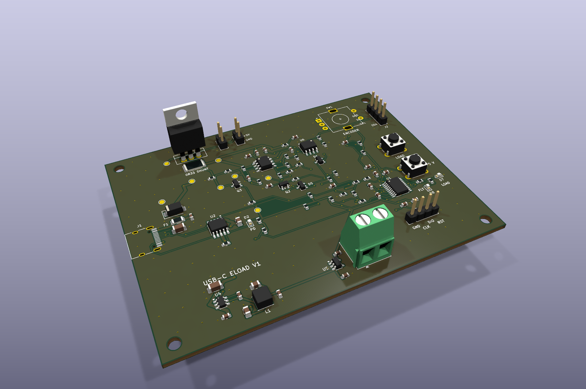
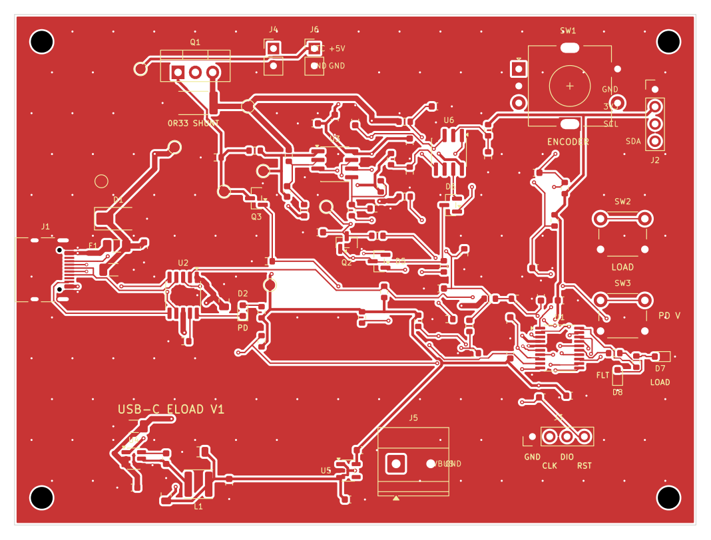

# USB-C-Eload-V1 — USB-C PD electronic load

Cheap DIY constant-current electronic load / bench tool. The USB-C port negotiates 5/9/12/15/20 V (USB PD sink) and a linear
MOSFET stage sinks an adjustable current (hardware-capped at about 1.09 A) from the negotiated rail. An STM32 handles the UI
(OLED + rotary encoder), measurement and PD voltage selection. The current loop and the safety cut-offs are analogue hardware,
independent of the firmware.

A KiCad 10 hardware design with STM32 firmware. Target: 5/9/12/15/20 V input, 0 to about 1 A constant current,
10 W passive or 20 W with a fan, 128×64 OLED, rotary encoder, hardware over-current and over-temperature cut-offs.
It was designed to be hand-assembled with paste and hot air (0603/0805, SOIC, TSSOP, ESSOP-EP, USB-C), as SMD practice and as a useful bench tool.

> **Status: designed and checked on paper, not built.** The schematic, PCB, fab files and firmware are complete.
> ERC: 0 violations. DRC: 0 violations, 0 unconnected, 0 schematic-parity issues (see `output/erc.json`, `output/drc_report.json`).
> The firmware compiles (24 KB of 32 KB flash) but has **never run on hardware**. No board has been ordered or powered yet.
> Expect to debug it, and read the open items below before ordering.
>
> **Safety:** this is a hobby design with no warranty. It dissipates up to 20 W in a MOSFET with a live drain tab (at VBUS),
> and the VBUS output terminal is not current-limited. The author is not responsible for damaged sources, boards or fingers.
>
> **Licences:** hardware (schematic, PCB, BOM, docs) CERN-OHL-P-2.0 (`LICENSE-HARDWARE.txt`). Firmware MIT (`firmware/LICENSE`).

## Sourcing notes (checked 16 Nov 2026)

- **Q1 (FQP30N06L) is discontinued.** onsemi marked it end-of-life, LCSC lists it as discontinued, and Mouser UK doesn't sell it.
  It was chosen because its datasheet has a published DC SOA line, which linear-mode operation needs. Options:
  - small eBay or broker lots of "FQP30N06L" (unverified origin, so treat as untrusted until tested), or
  - the Infineon IRLZ44N (LCSC C38774), which has the same TO-220 G-D-S pinout, runs from a 5 V gate and is readily available,
    but has a pulse-only SOA graph. Start at the 10 W limit if you use it.
  - The "FQP30N06L-VB" listed on LCSC (C878826) uses a recycled Vishay IRL540 datasheet with no DC SOA line, so it is not recommended for linear mode.
- **L1 (Sunlord SWPA4030S4R7MT, C57269)** isn't available through LCSC's international site. The substitute I picked for the cart is the APV
  ANR4018T4R7M (C7427102, 4×4 mm, 4.7 µH, 2.2 A saturation). Check its recommended land pattern against the KiCad
  `L_Sunlord_SWPA4030S` footprint before soldering.
- LCSC ships with minimum quantities (50 or 100 for 0603 parts), so a full set costs about $30 for parts plus shipping, and the PCBs are about $4 plus shipping for five.
  `output/LCSC_order_2boards.csv` is a ready-to-upload BOM (two boards plus spares, with the L1 substitution).

*KiCad 3D render of the board. The USB-C receptacle (left edge), rotary encoder and OLED module have no 3D models in KiCad's library, so they show as outlines only. In the finished tool the OLED plugs into J2, and the TO-220 MOSFET (top-left) sits on a heatsink that hangs over the board edge.*

## Files

| Path | What |
|---|---|
| `USB-C-Eload-V1.kicad_sch` | Schematic (single A2 sheet, label-connected, 102 parts) |
| `USB-C-Eload-V1.kicad_pcb` | **100 x 75 mm, 2-layer, routed** board |
| `USB-C-Eload-V1.kicad_pro` | Project, net classes and DRC rules |
| `eload.kicad_sym`, `sym-lib-table` | Project symbol library (CH224A) |
| `output/USB-C-Eload-V1_gerbers.zip` | Gerbers + drill files for JLCPCB (the same files are in `output/gerbers/`) |
| `output/BOM_V1.csv` | BOM with LCSC and MPN (grouped), as drawn in the schematic |
| `output/LCSC_order_2boards.csv` | LCSC BOM-tool upload: two boards plus spares, with the L1 substitute |
| `output/CPL_V1.csv` | Pick-and-place (top side only), origin = bottom-left corner of the board, Y up |
| `output/firmware/` | Compiled `.bin` / `.hex` / `.elf` (flash at 0x08000000 with an ST-Link) |
| `output/schematic.pdf`, `layout_top.png`, `layout_bottom.png` | Review documents |
| `firmware/` | PlatformIO project (`python -m platformio run`, `... -t upload` with an ST-Link on J3) |
| `hardware-tools/` | Python generators: `gen_eload.py` (schematic), `layout/` (PCB, a record of how the board was produced; paths inside are examples such as `C:\work\eload` and need adjusting, and routing needs Freerouting with Java 25) |

## Ordering from JLCPCB

- Upload `output/USB-C-Eload-V1_gerbers.zip`. Choose 2 layers, 100 x 75 mm, 1.6 mm, any colour, HASL (lead-free is easier for hand soldering).
- Minimum track/space is 0.15 mm and the smallest via is 0.5/0.3 mm (JLC's standard tier), so no "advanced" options are needed.
- **Do not select assembly** (you are soldering it yourself). If you want a stencil, order the `F_Paste` layer from the same Gerbers.
- `CPL_V1.csv` is provided in case you change your mind (all parts are on the top side).
  Check the rotations of the TSSOP/ESSOP/USB-C parts on JLC's preview before accepting.
- Buy the parts from `BOM_V1.csv` (or upload `output/LCSC_order_2boards.csv` to the LCSC BOM tool). **Q1 and L1 need substitutes, see "Sourcing notes" above.** Do not swap in a different MOSFET without checking its DC SOA (see below).
- Parts without an LCSC code: SW2/SW3 (any 6 x 6 mm 4-pin through-hole tact switch, 5 mm high), test points (bare pads, nothing to buy), mounting holes.

## Verified design decisions

| Area | Decision | Evidence |
|---|---|---|
| PD controller | **CH224A** (ESSOP-10-EP), I²C mode, Rset 6.8 k = 9 V power-up default | CH224K has no I²C, and its I/O-level table has no 15 V on CH224A. CH224A is pin-compatible with K and supports 5/9/12/15/20/28 V via I²C register 0x0A (addr 0x22/0x23). VHV tolerates 32 V. |
| Load MOSFET | **FQP30N06L** TO-220 | Only candidate with a *published DC SOA line* (about 3.9 A at 20 V, Tc = 25 °C). IRLZ44N / IRL540N SOA graphs show single pulses only. Logic-level, RthJC 1.9 °C/W, tab = drain = VBUS. |
| Rails | AP63205 buck → **5 V** → AP2112K LDO → **3.3 V** | 5 V op-amp rail gives at least 3.9 V gate drive (about 2.9 V needed worst case at 1 A). LDO gives a quiet ADC reference. TLV9062 abs max supply is 6 V. |
| Current sense | 0.33 Ω 1 % 2512 shunt, 330 mV at 1 A | Offset error ≤ ±5 mA; ADC 2.4 mA/LSB raw. |
| Setpoint | PWM (TIM14, 12-bit, 15.6 kHz) → /9.2 divider → 2nd-order RC (about 16 Hz) | 0.27 mA/step; passive hardware cap **1.09 A** nominal (worst about 1.14 A). |
| Loop | TLV9062 integrator (Rin 10 k, Cf 10 nF), 3 mV idle bias so it rails low (no wind-up) | Outer-loop crossover 50–800 Hz; above 1.6 kHz it is a unity follower (datasheet PM 55°). **Check with a load step at bring-up.** |

### Operating envelope (thermal reality)

Q1 dissipates V × I: **20 W at 20 V / 1 A**. TO-220 stack: Tj = Ta + P × (1.9 + RthCS + RthSA).

| Cooling | Safe continuous power |
|---|---|
| Heatsink about 6 °C/W + insulating pad | about 5–8 W |
| Heatsink about 3 °C/W + insulating pad, still air | about 10 W (Tj about 90 °C) |
| 3 °C/W heatsink + 5 V fan (J6), about 1.5 °C/W effective | **20 W** (Tj about 125 °C) |

20 W is therefore a *fan-cooled* rating. The firmware defaults to a 10 W limit and only allows 20 W after you select "fan fitted"
(long-press the PD button). Q1's tab is at VBUS: use a silicone pad and a shoulder washer if the heatsink can touch anything.
Q1 sits at the top-left, tab facing the top edge, so the heatsink can hang over the edge. Mount the 10 k NTC on the heatsink/tab.

### Protection architecture (independent of firmware)

KILL bus (active high) = OR of 4 sources via 2× BAT54C, clamping **GATE** (Q3, BSS138) and **VSET** (Q2, BSS138):

1. `LOAD_DIS`, pulled up to 3V3 by 10 k, so an MCU reset or hang means load off. The MCU drives it low to enable.
2. Over-temperature comparator (U3B): trips at about 98 °C, releases at about 84 °C (NTC on J4).
3. NTC open / very cold detect (U6A): trips if the NTC voltage is above 3.0 V, so an **unplugged NTC kills the load**.
4. Overcurrent comparator (U6B): trips at about 1.38 A (range 1.28–1.47 A) on the shunt, independent of the loop.

`HW_FAULT` (PA3) reports the KILL bus to the MCU. Input path order: USB-C → **F1 2 A fuse** → TVS (SMAJ20A, 32.4 V clamp), CH224A, buck, load.
Not protected: the CH224A abs max (32 V) is slightly below the TVS clamp at full surge current. Acceptable for a hobby tool,
but do not hot-plug it onto abusive sources. The VBUS output terminal (J5) is **not** current-limited; do not use it as a power injector.

## PCB notes

- 2 layers: signal routing on both, solid GND pours on both sides stitched with vias, every GND pad has its own via.
  Current routing was by Freerouting after a seeded simulated-annealing placement. Layout details are in `hardware-tools/layout/`.
- Net classes: Power (VBUS, SH_TOP) 0.8 mm tracks, Mid (5 V, 3V3, GATE, SW) 0.4 mm, everything else 0.2 mm.
- The shunt top node (SH_TOP) is tapped by R7 and the ADC filter. Measured trace resistance between the tap and the shunt pad is
  below 3 mΩ (under 1 % current error at worst), and the boot-time offset calibration removes the rest.
- J1 USB-C at the left edge, J5 screw terminal at the bottom, J3 SWD bottom-right, J2 OLED header, encoder and the two buttons on the right.
- 4× M3 holes at the corners. Use standoffs: the TO-220 heatsink, NTC lead and fan lead are all at the top-left of the board.
- CH224A has an exposed pad (pin 11, GND). The KiCad EP size (2.1 × 3.3 mm) is a library estimate, WCH does not publish it.
  Measure the real part before ordering a stencil.
- Silkscreen has some cosmetic overlaps (the title, a few labels); DRC silk checks are disabled for that reason. It does not affect function.

## MCU pin map (STM32G030F6P6, TSSOP-20)

| Pin | Net | Function |
|---|---|---|
| 1 PB8 / 2 PB9 / 3 PC15 | BTN_LOAD / BTN_PD / ENC_SW | Inputs, internal pull-up, button to GND |
| 6 NRST / 18 PA13 / 19 PA14 | NRST / SWDIO / SWCLK | J3 (PA14 is also BOOT0, leave unpulled) |
| 7 PA0 / 8 PA1 / 9 PA2 | VBUS_SENSE / I_SENSE / NTC_SENSE | ADC1_IN0/1/2 |
| 10 PA3 | HW_FAULT | Input (3.13 V when a comparator is killing the load) |
| 11 PA4 | SET_PWM | TIM14_CH1 (AF4) |
| 12 PA5 | LOAD_DIS | Output, **low = load allowed** (hi-Z/high = off) |
| 13 PA6 / 14 PA7 | ENC_A / ENC_B | Encoder (EXTI interrupts in firmware) |
| 15 PA8 / 20 PB3 | LED_FAULT / LED_LOAD | Outputs |
| 16 PA11 / 17 PA12 | I2C_SCL / I2C_SDA | CH224A + OLED (bit-banged in firmware; PA11/PA12 are I2C2 at reset) |

## Firmware

Build: `cd firmware && python -m platformio run` (output `firmware/.pio/build/eload_g030/`). A prebuilt copy is in `output/firmware/`.
Upload with an ST-Link on J3: `python -m platformio run -t upload`. J3 pins: 1 GND, 2 SWCLK, 3 SWDIO, 4 NRST. There is **no 3V3 pin**,
so power the board from USB-C while programming (the ST-Link only needs GND, SWCLK, SWDIO and NRST; leave its 3V3 pin unconnected).
The OLED is driven with U8x8 text mode (small flash footprint); integer maths only.

Controls:

| Input | Action |
|---|---|
| Encoder turn | Set the load current (step size from the encoder button) |
| Encoder press | Toggle the current step between 10 mA and 50 mA |
| BTN_LOAD | Load on/off; also clears a latched fault |
| BTN_PD short press | Next PD voltage (5/9/12/15/20 V); the load is switched off first |
| BTN_PD long press | Toggle 10 W (passive) / 20 W ("fan fitted") power limit |

Safety behaviour: boots at 5 V with the load off; faults are latched (hardware trip, over-temperature 90 °C, NTC fault, VBUS
below 80 % of the request, power above 125 % of the limit, current above 1.25 A); current is derated from 70 °C. The independent
watchdog (1 s) resets the MCU if it hangs, which releases LOAD_DIS and switches the load off.

Calibration constants are at the top of `src/main.cpp` (shunt value, VBUS divider, ADC reference assumed 3300 mV, NTC table).
The zero-current offset is calibrated at boot with the load off.

## Assembly notes

- Hot-air/paste parts: CH224A (EP), STM32 TSSOP-20, TLV9062 ×2 (SOIC-8), AP63205 (TSOT-23-6), AP2112K, all the 0603/0805/1206 parts, USB-C (SMD signal pins plus 4 through-hole shell pins).
- Hand-solder: TO-220 (+ heatsink), encoder, buttons, pin headers, screw terminal.
- SSD1306 0.96" I²C modules come in two pin orders (GND-VCC-SCL-SDA vs VCC-GND-SCL-SDA). J2 is wired GND, 3V3, SCL, SDA. **Check your module before plugging it in.**
- NTC (10 k, B3950): bond it to the Q1 tab with thermal epoxy/Kapton, then plug it into J4. The load will not enable without it.

## Bring-up plan

1. Visual and continuity check, no Q1 fitted yet: with a 5 V source, 5 V rail about 5.0 V and 3V3 about 3.30 V.
2. Program via SWD; confirm the load stays off (TP_GATE about 0 V) while PA5 is hi-Z.
3. With a 9 V source: check `VSET` tracks the PWM, and that the Q1 gate rises, using a resistor load before fitting a heatsinked Q1.
4. Calibrate shunt/ADC, step the load 0 → 0.5 → 1 A at 5 V and check settling and no oscillation (TP_AMPOUT, TP_GATE).
5. Trip tests: unplug the NTC (load must drop), warm the NTC (trip at about 98 °C), force VSET high for the overcurrent test (about 1.38 A).
6. Thermal run: 10 W passive, then 20 W with the fan, watching the NTC and Q1 case temperature.

## Open items

- Check the real gate voltage at 1 A on the first board with a 5 V source (the 5 V rail may sag to about 4.5 V).
- Check the loop step response; adjust Cf (10 nF) if it rings.
- Confirm the CH224A exposed-pad size (stencil) and the OLED module pin order.
- Firmware is untested on hardware (pin and AF assumptions come from the ST open pin data); expect to tune calibration constants.
- Fan is always on when fitted. Consider a thermostat or thermal fuse as an extra independent cut-off.
- V2 ideas: current-limited power injection, constant-power/constant-resistance modes, Ah/Wh counting.
